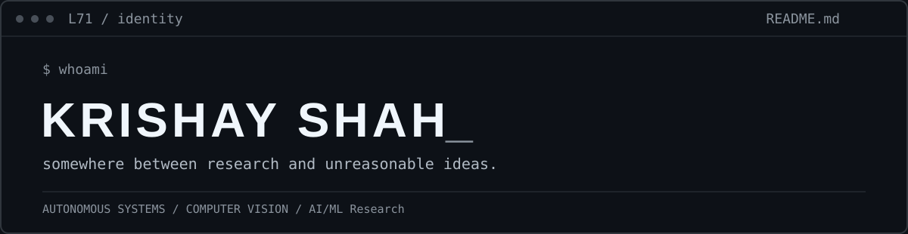

  

Computer Science & Engineering · Vadodara, India

### `~/selected-systems`

|  | System | What it does |
| :-- | :-- | :-- |
| `01` | **[U.L.T.R.O.N.](https://github.com/Luciifer71/U.L.T.R.O.N)** | Local-first, event-driven AI agent with reasoning, voice, memory and controlled system actions. *Active development.* |
| `02` | **[Hydro-Vision-3D](https://github.com/Luciifer71/Hydro-vision-3D)** | Turns drone and inspection video into tracked, prioritized civic hazard incidents. |
| `03` | **[Meshmerize](https://github.com/Luciifer71/stm32-maze-solving-robot)** | STM32 line-following and maze-solving robot. *Hardware and firmware work ongoing.* |
| `04` | **[FinLens AI](https://github.com/Luciifer71/FinLens-AI-Transparent-Financial-Readiness-Platform)** | Explainable financial-readiness modelling and interactive scenario analysis. |

### `~/working-across`

`autonomous agents` · `computer vision` · `robotics` · `embedded systems` · `applied ML` · `quantitative systems`

### `~/documents`

[`resume.pdf`](documents/resume.pdf) — selected experience and projects  
[`curriculum-vitae.pdf`](documents/curriculum-vitae.pdf) — academic and research-oriented record

### `~/elsewhere`

[LinkedIn](https://www.linkedin.com/in/krishay-shah-3180b432b/) · [Repositories](https://github.com/Luciifer71?tab=repositories) · [Email](mailto:shahkrishay4@gmail.com)

still building.
